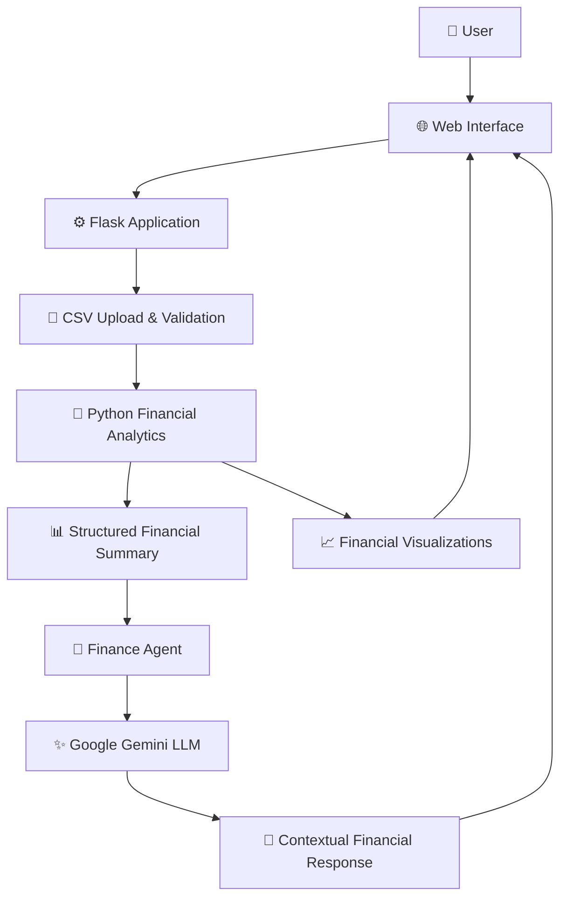
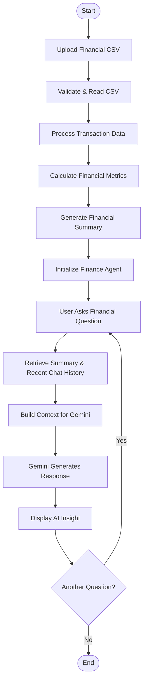
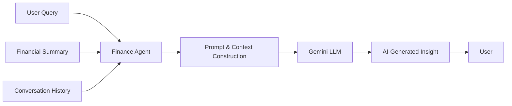
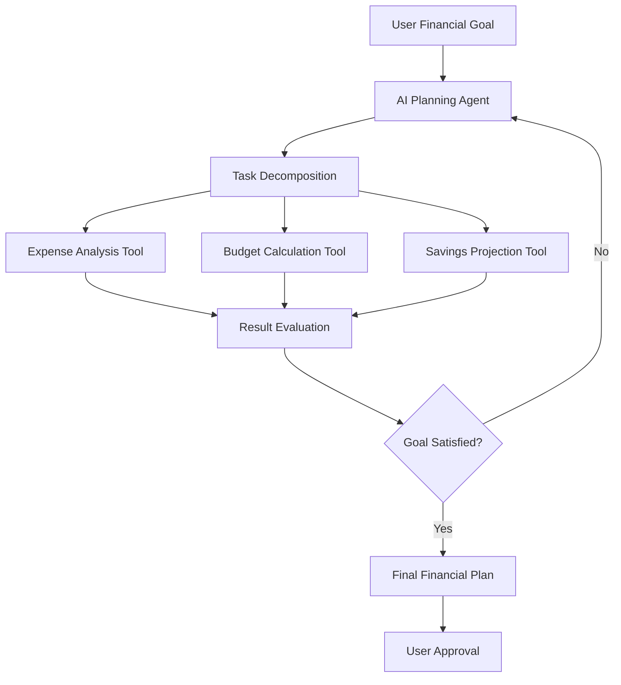

# 💰 Personal Finance Planner
### AI-Powered Financial Intelligence Assistant | Python • Flask • Google Gemini • LLM

<p align="center">
  <strong>Transform raw financial transactions into meaningful financial intelligence.</strong>
</p>

<p align="center">
  
  
  
  
  
  
</p>

---

## 🌟 Overview

**Personal Finance Planner** is an AI-powered financial analysis and conversational assistance application that helps users understand their spending habits, analyze expenses, and make more informed financial decisions.

Traditional expense trackers primarily display transaction records, totals, and charts. This project takes the next step by combining **deterministic financial analytics with Large Language Model (LLM)-powered reasoning**.

Users can upload their financial transaction data in CSV format. The application processes the transactions using Python, calculates meaningful financial metrics, and provides the Gemini-powered assistant with structured financial context. Users can then ask questions in natural language and receive contextual explanations, spending insights, and practical suggestions.

### 🎯 Core Idea

> Convert financial data into financial intelligence — moving from *What did I spend?* to *Why am I spending this way, and how can I improve?*

## ✨ Key Features

| Feature | Description |
|---|---|
| 📂 CSV Financial Data Upload | Import transaction records through a CSV file |
| 📊 Automated Expense Analysis | Calculate total expenses, averages, and category-wise spending |
| 🧠 AI-Powered Financial Assistant | Ask questions about your financial data using Google Gemini |
| 💬 Natural Language Interaction | Communicate with the system using conversational questions |
| 📈 Financial Insights | Understand spending patterns and identify major expense categories |
| 💡 Budget Recommendations | Explore practical suggestions based on available financial information |
| 📉 Spending Visualization | View financial information through interactive charts |
| 🔄 Conversation Context | Maintain recent conversation history for contextual follow-up questions |
| 🔐 Session-Based Interaction | Maintain separate application sessions for users |

## 🧩 Problem Statement

Managing personal finances involves more than recording transactions. People often struggle to:

- Identify where most of their money is going.
- Understand recurring and unnecessary expenses.
- Analyze spending patterns across categories.
- Interpret financial data without manually calculating metrics.
- Convert financial observations into practical decisions.

Most basic expense trackers provide numerical information but do not offer an interactive way to understand it.

### 💡 Proposed Solution

The Personal Finance Planner combines Python-based financial computation and Gemini-based natural-language understanding to create an interactive financial assistant.

Instead of relying entirely on an LLM to calculate financial figures, the application first processes transaction data using Python. The resulting structured financial summary is then supplied to Gemini as contextual information.

This separation makes the application more reliable for numerical analysis while retaining the flexibility of conversational AI.

---

## 🏗️ System Architecture

The application follows a layered architecture consisting of a frontend, Flask backend, financial analytics layer, and Gemini LLM integration.



### Architecture Components

**1. Frontend Layer**
- HTML, CSS, and JavaScript.
- Provides the user interface for uploading financial data.
- Displays financial summaries, charts, and AI-generated responses.
- Uses Chart.js for interactive visualizations.
- Uses Marked.js for rendering formatted Markdown responses.

**2. Backend Layer — Flask**
- Handles HTTP requests and application routes.
- Manages CSV uploads and user sessions.
- Coordinates communication between the frontend, analytics engine, and AI agent.
- Returns application data through JSON responses.

**3. Financial Analytics Engine — Python**
- Reads and processes uploaded transaction records.
- Calculates expense statistics and category-wise totals.
- Generates structured financial summaries.
- Supplies calculated information to the AI assistant.

**4. AI Reasoning Layer — Google Gemini**
- Uses the Google Gemini API through the `google-genai` SDK.
- Interprets natural-language financial questions.
- Receives the user's financial summary as context.
- Generates conversational insights and explanations.
- Uses recent conversation history to support follow-up questions.

---

## 🔄 Application Workflow

The application follows a data-processing and AI-assisted reasoning workflow.



### Step-by-Step Explanation

1. **Data Input:** The user uploads a CSV file containing financial transactions.
2. **Data Processing:** The Flask backend receives the file and passes it to the financial analytics component.
3. **Financial Computation:** Python processes the available transaction data and calculates financial metrics.
4. **Context Generation:** The calculated metrics are converted into a structured financial summary.
5. **Agent Initialization:** A FinanceAgent is initialized with the user's financial context.
6. **User Interaction:** The user asks questions such as "Which category has the highest expenses?"
7. **Context Preparation:** The application combines the financial summary, system instructions, and recent conversation history.
8. **LLM Reasoning:** Gemini interprets the question and generates a contextual response.
9. **Output:** The frontend displays the AI-generated financial explanation.

---

## 🧠 AI, ML & Agentic AI Concepts

This project demonstrates the practical integration of AI concepts into a real-world application.

### 1. Large Language Models (LLMs)

The application integrates Google's Gemini model to understand natural-language questions and generate contextual financial responses.

**Concepts applied:**
- Natural Language Understanding (NLU)
- Natural Language Generation (NLG)
- Prompt Engineering
- Contextual Reasoning
- Conversational AI
- LLM API Integration

### 2. AI Agent Architecture

The `FinanceAgent` class acts as the central conversational intelligence component.

It maintains financial context, prepares instructions, manages recent conversation history, and communicates with the Gemini model.

Its workflow can be represented as:



**Agent-related concepts demonstrated:**
- Goal-oriented conversational assistance.
- Context-aware question answering.
- Short-term conversational memory.
- LLM-based reasoning.
- Separation of application logic and AI interaction.

**Important implementation distinction:** This version demonstrates an LLM-powered agent-style assistant. It does not yet implement autonomous planning loops, external tool execution through Gemini function calling, or a multi-agent system.

### 3. Prompt Engineering

Prompt engineering is used to guide the model's behavior and provide relevant financial context.

The application constructs a prompt using:
- Financial information calculated from the uploaded CSV.
- Instructions defining the assistant's role.
- The user's current question.
- Recent conversation history.

This helps Gemini generate responses relevant to the user's actual financial information rather than responding only with generic financial advice.

### 4. Contextual Memory

The application maintains recent conversation history using a bounded history of up to 20 conversation turns.

This allows users to ask follow-up questions without repeating all the context.

For example:

**User:** What is my highest expense category?

**AI:** Your highest expense category is Food.

**User:** How can I reduce it?

The assistant can use the previous conversation and financial summary to provide a more relevant answer.

### 5. Deterministic Analytics + LLM Reasoning

A key architectural decision is separating numerical computation from language generation.

| Python Analytics | Gemini LLM |
|---|---|
| Processes transaction data | Understands user questions |
| Calculates expense totals | Interprets financial context |
| Aggregates categories | Explains spending patterns |
| Computes averages | Generates conversational insights |
| Produces structured summaries | Suggests possible improvements |

This hybrid approach reduces dependence on LLM-generated numerical calculations.

---

## 📐 Financial Analytics & Logic

The application uses Python to calculate financial information from uploaded transactions.

### Important Financial Metrics

**1. Total Expenses**

\[
\text{Total Expenses} = \sum_{i=1}^{n} E_i
\]

Where \(E_i\) represents an individual expense.

**2. Average Expense**

\[
\text{Average Expense} =
\frac{\text{Total Expenses}}{\text{Number of Transactions}}
\]

**3. Category-Wise Expense**

\[
\text{Category Expense} =
\sum_{i=1}^{n} E_i
\]

Here, only transactions belonging to the selected category are included.

**4. Category Spending Percentage**

\[
\text{Category \%} =
\frac{\text{Category Expense}}{\text{Total Expenses}}
\times 100
\]

These calculations help users understand their spending distribution and identify categories that contribute most to their expenses.

---

## 🛠️ Technology Stack

| Technology | Purpose |
|---|---|
| Python | Core programming language and financial data processing |
| Flask | Backend web framework and REST API routes |
| Google Gemini | LLM-powered conversational intelligence |
| Google GenAI SDK | Communication with Gemini |
| Pandas | Financial transaction processing, where used by the implementation |
| HTML5 | Frontend structure |
| CSS3 | User interface styling |
| JavaScript | Frontend interaction and API communication |
| Chart.js | Financial data visualization |
| Marked.js | Markdown response rendering |
| python-dotenv | Secure environment variable configuration |

---

## 📁 Project Structure

```text
Personal-Finance-Planner/
│
├── app.py                  # Flask backend and API routes
├── finance_agent.py        # FinanceAgent and Gemini integration
│
├── templates/
│   └── index.html          # Frontend interface
│
├── uploads/
│   └── .gitkeep            # Keeps the upload directory in Git
│
├── .env.example            # Environment variable template
├── .gitignore              # Files excluded from Git
├── requirements.txt        # Python dependencies
├── README.md               # Project documentation
└── Test_Question.txt       # Project testing questions
```

---

## ⚙️ Installation & Setup

### Prerequisites

- Python 3.10 or later.
- Git.
- Google Gemini API key.
- Internet connection for Gemini API access.

### 1. Clone the Repository

```bash
git clone https://github.com/YOUR-USERNAME/Personal-Finance-Planner.git
cd Personal-Finance-Planner
```

### 2. Create a Virtual Environment

```bash
python -m venv .venv
```

Activate it on Windows:

```powershell
.venv\Scripts\Activate.ps1
```

Activate it on macOS/Linux:

```bash
source .venv/bin/activate
```

### 3. Install Dependencies

```bash
pip install -r requirements.txt
```

### 4. Configure Environment Variables

Create a `.env` file in the root directory.

```env
GEMINI_API_KEY=your_actual_gemini_api_key
FLASK_SECRET_KEY=your_secure_random_secret
```

Get your Gemini API key:

https://aistudio.google.com/apikey

**Security:** Never commit your `.env` file or expose your API key in source code, screenshots, or public repositories.

### 5. Run the Application

```bash
python app.py
```

Open your browser:

```text
http://localhost:5000
```

---

## 🔌 Backend API Routes

| Method | Endpoint | Purpose |
|---|---|---|
| GET | `/` | Loads the application interface |
| GET | `/api/status` | Checks application/session status |
| POST | `/api/upload` | Uploads and processes financial CSV data |
| POST | `/api/chat` | Sends a financial question to the AI assistant |
| GET | `/api/summary` | Retrieves the financial summary |
| POST | `/api/reset` | Resets the conversational session |

---

## 🧪 Example Use Cases

After uploading a valid financial transaction CSV, users can ask questions such as:

| User Question | Expected Assistance |
|---|---|
| Which category has the highest expenses? | Identifies the largest spending category |
| What is my total expenditure? | Explains the calculated expense total |
| What is my average transaction amount? | Provides average spending information |
| Where can I reduce my expenses? | Suggests possible areas for improvement |
| Analyze my spending habits. | Explains patterns based on available data |
| How can I improve my budget? | Provides contextual budgeting suggestions |

*Responses depend on the uploaded dataset and the information available to the model.*

---

## 🔐 Security & Responsible AI

Financial information is sensitive, so the application follows several basic security practices:

- API keys are stored in environment variables.
- `.env` is excluded from Git.
- Uploaded financial files are excluded from Git.
- CSV upload size is limited to 5 MB.
- Flask sessions are used to separate user interactions.
- Financial calculations are performed by application logic rather than relying solely on LLM output.

**Limitations to understand:**
- Gemini API access requires internet connectivity and a valid API key.
- Uploaded data must follow the expected CSV structure.
- The current application keeps agent objects in memory, so session state is not persistent across application restarts.
- The LLM can still produce inaccurate interpretations; financial outputs should be checked before making important decisions.
- This application is an educational financial analysis assistant, not a certified financial advisor.

---

## 🚀 Future Enhancements

The architecture can be extended toward a more autonomous Agentic AI financial assistant.

| Enhancement | Proposed Capability |
|---|---|
| 🤖 Agentic Planning | Break complex financial requests into smaller tasks |
| 🔧 Gemini Function Calling | Allow the model to invoke approved financial analysis functions |
| 📊 Advanced Analytics | Add monthly trends, budget comparisons, and forecasting |
| 🧠 Persistent Memory | Store user-approved financial preferences and historical context |
| 📚 Financial RAG | Retrieve relevant financial education documents and explain concepts using sources |
| 🎯 Budget Optimization Agent | Generate and evaluate budget plans |
| 📅 Goal-Based Planning | Track savings goals and financial targets |
| 🔐 Authentication | Introduce secure user accounts and persistent storage |
| 📱 Responsive Dashboard | Improve the experience across desktop and mobile devices |

### Future Agentic AI Workflow



*This diagram represents a proposed future architecture, not functionality implemented in the current version.*

---

## 🎓 Learning Outcomes

Developing this project provided practical experience with:

- Integrating LLM APIs into a Python application.
- Designing a conversational AI assistant.
- Understanding the architecture of an AI-agent-style application.
- Implementing prompt engineering and contextual conversations.
- Processing structured financial data using Python.
- Designing backend REST API endpoints using Flask.
- Connecting frontend interfaces with backend services.
- Visualizing financial information using Chart.js.
- Managing API keys and environment variables.
- Understanding the difference between deterministic computation, LLM reasoning, and autonomous Agentic AI.

---

## 👩‍💻 Author

**Sakshi Zurale**

Electronics & Computer Engineering | AI/ML Enthusiast

- GitHub: [Sakshi-Zurale](https://github.com/Sakshi-Zurale)
- LinkedIn: [Sakshi Ramdas Zurale](https://linkedin.com/in/sakshi-ramdas-zurale)
- Portfolio: [Personal Portfolio](https://sakshi-portfolio-4752.vercel.app/)

---

## ⭐ Support

If you find this project interesting, consider giving the repository a ⭐ on GitHub.

<p align="center">
  <strong>From Financial Data to Intelligent Decisions. 💡</strong>
</p>
